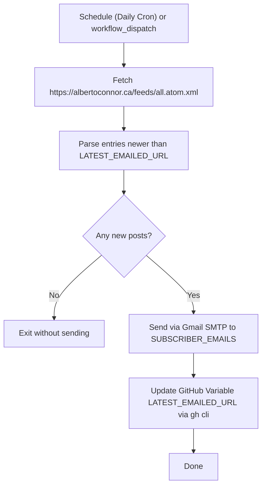

# Blog Post Email Notification Plan

This plan outlines the architecture and implementation steps to automatically email new blog posts from [albertoconnor.ca](https://albertoconnor.ca) to a subscriber list (starting with Beth) using GitHub Actions and Gmail SMTP.

---

## 1. System Architecture

---

## 2. State & Privacy Strategy

### Preventing Duplicate Sends on Date Edits
- Pelican generates Atom entry IDs (`tag:albertoconnor.ca,DATE:/slug.html`) based on the `Date:` header.
- Modifying the `Date:` of an article prior to or after publishing changes the Atom GUID, but the canonical URL / slug remains stable (e.g. `https://albertoconnor.ca/lesson-1-apps-over-layers.html`).
- State is tracked using the **canonical URL** (`LATEST_EMAILED_URL`) instead of the Atom GUID.

### Privacy for Public Repository
- Subscriber email addresses are stored exclusively in encrypted **GitHub Repository Secrets**, never in git-tracked files.
- Secrets are automatically masked in GitHub Actions run logs.

---

## 3. GitHub Configuration Requirements

### Secrets (`Settings -> Secrets and variables -> Actions -> Secrets`)
1. `GMAIL_USER`: The sender Gmail address.
2. `GMAIL_APP_PASSWORD`: 16-character Google App Password (generated at [Google Account Security > App Passwords](https://myaccount.google.com/apppasswords)).
3. `SUBSCRIBER_EMAILS`: Comma-delimited list of recipient addresses (e.g., `beth@example.com,albert@example.com`).

### Variables (`Settings -> Secrets and variables -> Actions -> Variables`)
1. `LATEST_EMAILED_URL`: Initialized to the URL of the most recently published article (e.g., `https://albertoconnor.ca/lesson-1-apps-over-layers.html`).

---

## 4. Components to Implement

### A. Python Dispatch Script: `scripts/send_newsletter.py`
- **Zero third-party dependencies**: Uses Python standard library modules (`urllib.request`, `xml.etree.ElementTree`, `smtplib`, `ssl`, `email.message`, `os`, `subprocess`).
- **Logic**:
  1. Read `LAST_SENT_URL` from environment (`vars.LATEST_EMAILED_URL`).
  2. Fetch Atom feed from `https://albertoconnor.ca/feeds/all.atom.xml`.
  3. Extract entries in chronological order. Collect all entries appearing after `LAST_SENT_URL`.
  4. Construct multipart email (plain text + HTML summary/link).
  5. Connect to `smtp.gmail.com:465` via SSL and send to `SUBSCRIBER_EMAILS`.
  6. Execute `gh variable set LATEST_EMAILED_URL --body "<newest_url>"` to update state.

### B. GitHub Workflow: `.github/workflows/newsletter.yml`
- **Triggers**:
  - `schedule`: Daily cron (e.g., `0 13 * * *`).
  - `workflow_dispatch`: Manual trigger button in GitHub UI for on-demand sends and testing.
- **Permissions**:
  - `contents: read`
  - `variables: write` (allows `gh variable set` using `secrets.GITHUB_TOKEN`).
- **Steps**:
  - Checkout repository.
  - Setup Python.
  - Execute `python scripts/send_newsletter.py`.

---

## 5. Implementation Checklist

- [ ] Add `GMAIL_USER`, `GMAIL_APP_PASSWORD`, and `SUBSCRIBER_EMAILS` to GitHub Secrets.
- [ ] Add `LATEST_EMAILED_URL` to GitHub Variables.
- [ ] Create directory `scripts/` and implement `scripts/send_newsletter.py`.
- [ ] Create `.github/workflows/newsletter.yml`.
- [ ] Run a test execution using `workflow_dispatch` with a personal test email in `SUBSCRIBER_EMAILS`.
- [ ] Verify `LATEST_EMAILED_URL` variable updates automatically upon success.

---

## 6. Future Migration Path (50+ Subscribers)

When subscriber volume reaches the point where personal Gmail rate limits or deliverability become constraints:
1. **Resend / Postmark / SendGrid**: Swap the SMTP sender in `scripts/send_newsletter.py` to an API call while keeping the same workflow and state tracking.
2. **Ghost / Buttondown**: Import subscribers into Ghost/Buttondown and connect the Atom feed directly to their newsletter distribution feature.
